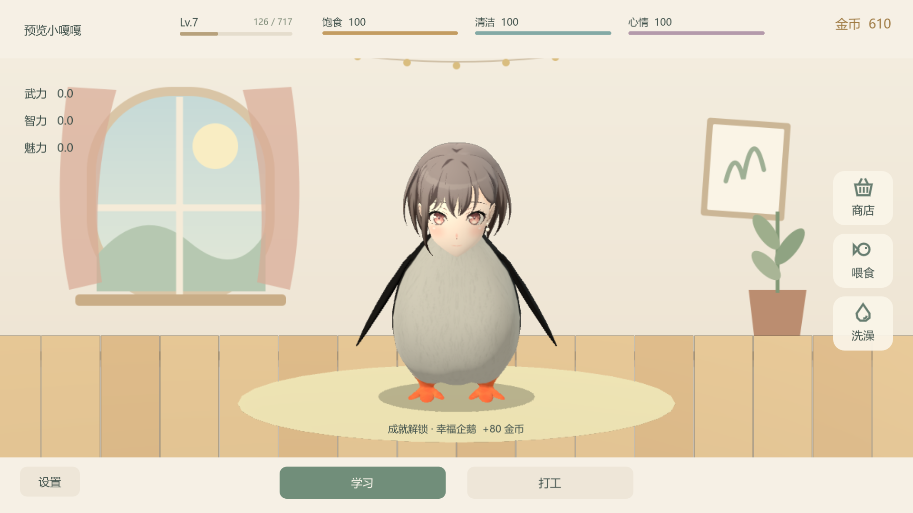

# 养一只咕咕嘎嘎吧！

一款使用 Godot 4 制作的 Windows 单机 3D 养成小游戏。陪小嘎嘎吃饭、洗澡、学习和打工，解锁动作、成就与装扮。



## 下载与运行

前往 [Releases](https://github.com/TTZW1001/GuguGaga/releases/latest) 下载 Windows 压缩包，解压后双击其中的 `.exe`。无需安装、联网，全程静音。

当前版本 **1.3.2**。本地打包输出在 `build/`，不提交到 Git；发行包附带使用说明、素材署名和 Godot 许可。

窗口默认 16:9，按屏幕大小调整，最低 960 × 540。使用 Compatibility / OpenGL 3.3 渲染。

## 游玩

- 点击头、肚子、翅膀或脚；按住头部轻轻移动可抚摸。
- 拖动地面旋转角色，停下 10 秒后回正。
- 喂食、洗澡菜单支持连续使用物品，点击外面、再次点击入口或按 Esc 收起。
- 点击名字查看资料、成就和装扮。左侧模型可独立旋转和预览动作，改名与装扮自动保存。
- 学习和打工同时只能进行一项；照顾不中断任务，退出后任务继续。
- 升级解锁动作，日常待机时也会随机出现。Lv.20 解锁「高雅人士」套装，与头饰、颈饰互斥。
- 设置分为「常规 / 关于」：可调整窗口大小、30 / 60 FPS、后台省电，查看游玩方法与素材来源。
- 弹窗内容可用滚轮查看；右上角、弹窗外和 Esc 均可关闭。

存档沿用 `%APPDATA%/Godot/app_userdata/企鹅小日子/penguin.json`，备份为同目录 `.bak`。更新版本无需搬运存档。请勿同时运行新旧版本，避免写入同一存档。

## 开发与打包

使用 **Godot 4.6.2** 打开根目录的 `project.godot`，按 F5 运行项目。已有模型和贴图可直接导入，运行游戏不需要安装 Blender。

Windows 导出模板放在 `tools/templates/`。可使用 Godot 官方导出模板，或运行 `python tools/fetch_templates.py` 下载本项目所需的 Windows 模板。

```powershell
python tools/package_windows.py --godot "你的 Godot 控制台程序路径.exe"
```

脚本会生成独立 EXE、Windows ZIP 和校验文件。版本号读取 `project.godot`；导出版本信息维护在 `export_presets.cfg`。

主要目录：

| 目录 | 内容 |
| --- | --- |
| `scripts/` | 养成逻辑、界面和程序动作 |
| `assets/` | 游戏模型、贴图、图标和素材署名 |
| `assets/incoming/` | 模型原包与可编辑 Blender 源文件，不参与导出 |
| `tools/` | 建模、导出、预览和打包脚本 |
| `tests/` | 状态、模型、界面及 Windows 程序测试 |
| `docs/` | 文案调整记录、截图和已确认的服饰预览 |
| `build/` | 本机生成的发行文件，不进入版本控制 |

状态测试可运行 `godot --headless --path . --script tests/test_state.gd`；界面与模型测试需要图形环境。测试时请把 `APPDATA` 指向 `tests/runtime/` 下的独立目录，避免读取个人游戏存档。Windows 程序测试脚本为 `tools/test_windows_release.py`，额外需要 Pillow 和 psutil。

## 素材与署名

养成玩法参考 QQ 宠物。主角为「企鹅高松灯」组合模型，身体作者 Guilherme Navarro，备用企鹅作者 nicoma；头部与身体各有来源和许可说明。完整署名及模型改动见 [assets/CREDITS.md](assets/CREDITS.md)，Godot 引擎许可见 [assets/GODOT_LICENSE.txt](assets/GODOT_LICENSE.txt)。配饰、场景与动作道具由本项目制作。

[服饰预览](docs/previews/accessories) · [文案调整记录](docs/文案调整.md)
