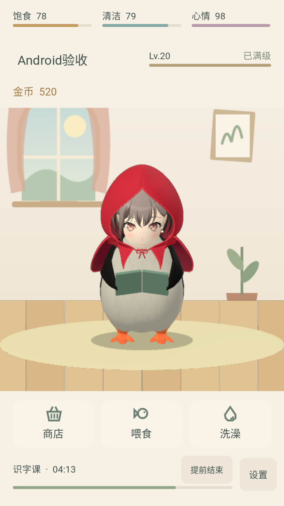

# 养一只咕咕嘎嘎吧！

一款使用 Godot 4 制作的 Windows / Android 单机 3D 养成小游戏。陪小嘎嘎吃饭、洗澡、学习和打工，解锁动作、成就与装扮。两个平台共用同一工程、玩法、存档格式、模型与动作，界面和系统操作按平台适配。

Windows 与 Android 统一在 `master` 维护；`android` 保留本次移植的开发记录。电脑版保持横屏窗口和鼠标操作，安卓版采用独立竖屏布局与触控操作，两个平台共享养成逻辑、数据、模型和动作。


安卓竖屏实际运行画面（Android 12 模拟器）：



## 下载与运行

前往 [1.3.2 Release](https://github.com/TTZW1001/GuguGaga/releases/tag/v1.3.2)，按设备选择下载。两个平台均为离线单机游戏，全程静音，无需账号。

| 平台 | 下载与运行 | 设备要求 |
| --- | --- | --- |
| Windows | [Windows ZIP](https://github.com/TTZW1001/GuguGaga/releases/download/v1.3.2/GuguGaga-1.3.2-Windows.zip)，解压后双击 `.exe`；也可下载[独立 EXE](https://github.com/TTZW1001/GuguGaga/releases/download/v1.3.2/GuguGaga-1.3.2.exe)直接运行 | Windows 64 位、OpenGL 3.3 |
| Android | [安卓 APK](https://github.com/TTZW1001/GuguGaga/releases/download/v1.3.2/GuguGaga-1.3.2-android.apk)，下载后安装，按系统提示允许该来源安装 | Android 7.0+、ARM64 / x86_64、OpenGL ES 3.0 |

当前版本 **1.3.2**，同一个 Release 提供原 Windows 1.3.2 与新增安卓安装包。Windows 默认 16:9，最低窗口 960 × 540；安卓固定竖屏，适配不同屏幕比例与安全区域。本地打包输出在 `build/`，不提交到 Git；Windows ZIP 附带使用说明和署名，APK 内包含素材署名与 Godot 许可。

安卓包使用长期自签名并关闭调试，后续更新可直接覆盖安装。已在 Android 12 MuMu 模拟器验证启动、触控、布局、任务、装扮、后台/锁屏恢复、存档恢复及覆盖升级；Windows 导出程序通过 92 项回归检查。物理手机的发热、耗电及不同厂商兼容性尚未验证。

## 游玩

- 点击头、肚子、翅膀或脚；按住头部轻轻移动可抚摸。
- 拖动地面旋转角色，停下 10 秒后回正。
- 喂食、洗澡菜单支持连续使用物品，使用成功后保持打开；点击外面或再次点击入口可收起。
- 点击名字查看资料、成就和装扮。预览模型可独立旋转和播放动作，改名与装扮自动保存，预览不打断主场景任务。
- 学习和打工同时只能进行一项；照顾不中断任务，退出后任务继续。
- 升级解锁动作，日常待机时也会随机出现。Lv.20 解锁「高雅人士」套装，与头饰、颈饰互斥。
- 设置分为「常规 / 关于」：可调整 30 / 60 FPS、后台省电，查看游玩方法、素材来源和仓库链接。
- 弹窗右上角、弹窗外均可关闭。旋转模型不计互动。

| 操作 | Windows | Android |
| --- | --- | --- |
| 点击、抚摸与旋转 | 鼠标点击、按住并拖动 | 手指轻触、按住并滑动 |
| 长内容 | 鼠标滚轮 | 手指滑动 |
| 关闭菜单或弹窗 | Esc | 系统返回操作优先关闭当前菜单或弹窗 |
| 「我的企鹅」 | 左侧模型、右侧标签与内容 | 上方模型和标签固定，仅下方内容滚动 |
| 平台设置 | 窗口尺寸、打开存档文件夹 | 隐藏 PC 窗口相关选项 |

Windows 存档沿用 `%APPDATA%/Godot/app_userdata/企鹅小日子/penguin.json`，备份为同目录 `.bak`，更新无需搬运存档。请勿同时运行新旧版本，避免写入同一存档。

Android 存档位于应用私有目录；切后台、锁屏时保存，恢复或重新启动时结算任务，并保留损坏存档的备份恢复机制。正式包覆盖安装保留存档，卸载会删除存档；预览包与正式包存档独立。PC 与手机各自保存进度，没有账号、云存档或跨设备同步。

## 开发与打包

使用 **Godot 4.6.2** 打开根目录的 `project.godot`，按 F5 运行项目。已有模型和贴图可直接导入，运行游戏不需要安装 Blender。

Windows 导出模板放在 `tools/templates/`。可使用 Godot 官方导出模板，或运行 `python tools/fetch_templates.py` 下载本项目所需的 Windows 模板。

```powershell
python tools/package_windows.py --godot "你的 Godot 控制台程序路径.exe"
```

脚本会生成独立 EXE、Windows ZIP 和校验文件。版本号读取 `project.godot`；导出版本信息维护在 `export_presets.cfg`。

主要目录：

| 目录 | 内容 |
| --- | --- |
| `scripts/` | 养成逻辑、界面和程序动作 |
| `assets/` | 游戏模型、贴图、图标和素材署名 |
| `assets/incoming/` | 模型原包与可编辑 Blender 源文件，不参与导出 |
| `tools/` | 建模、导出、预览和打包脚本 |
| `tests/` | 状态、模型、界面、生命周期测试与隔离测试输出 |
| `docs/` | 文案调整记录、截图和已确认的服饰预览 |
| `build/` | 本机生成的发行文件，不进入版本控制 |

状态测试可运行 `godot --headless --path . --script tests/test_state.gd`；界面与模型测试需要图形环境。测试时请把 `APPDATA` 指向 `tests/runtime/` 下的独立目录，避免读取个人游戏存档。Windows 程序测试脚本为 `tools/test_windows_release.py`，额外需要 Pillow 和 psutil。

安卓布局可通过 `godot --path . -- --portrait-preview` 在电脑预览。手机弹窗采用紧凑居中布局；“我的企鹅”的模型、标签与关闭按钮固定，仅下方内容滚动。自动布局检查使用 `--script tests/test_portrait.gd -- --portrait-preview`，并同样隔离 `APPDATA`。预览 APK 使用独立包名 `com.ttzw1001.gugugaga.preview`，不连接或迁移 Windows 存档。

`tools/test_android_preview.py --adb "ADB 路径" --serial "设备序列号"` 在已安装并领养过的测试包中使用隔离测试数据，要求 1080×1920 竖屏和 Pillow；会替换该测试包的存档。可用 `--capture-prefix` 区分截图批次。

复用本机 JDK 17、Android SDK（Platform 35 / Build Tools 35.0.x），下载官方调试模板后打包：

```powershell
python tools/fetch_templates.py --android-debug
python tools/package_android.py --godot "Godot 控制台程序路径.exe" --sdk "Android SDK 目录" --jdk "JDK 17 目录"
```

使用 `--output build/android/GuguGaga-1.3.2-compact-preview.apk` 可另存紧凑弹窗预览，保留上一版 APK。

正式构建使用官方 release 模板和自行生成、长期保存的专用密钥，不使用临时调试密钥：

```powershell
python tools/fetch_templates.py --android-release
python tools/package_android.py --release --godot "Godot 控制台程序路径.exe" --sdk "Android SDK 目录" --jdk "JDK 17 目录" --signing-file "仓库外目录/release-signing.json"
```

私有签名配置包含 `keystore`（密钥路径，可相对配置文件）、`alias` 和 `password`；密钥与配置一起备份到安全位置，不提交 Git、不随 APK 分发。正式 APK 为 `build/android/GuguGaga-1.3.2-android.apk`，包名 `com.ttzw1001.gugugaga`，关闭调试，支持 Android 7.0+、OpenGL ES 3.0、ARM64 / x86_64。签名不需要购买证书。后续更新保持包名与密钥，增加 `version/code`；覆盖安装保留存档，卸载会删除存档。预览包使用独立包名，正式包不自动迁移预览存档。

后台暂停会保存进度并停止安卓模型与 3D 预览渲染，恢复按真实时间结算，重复恢复不会重复奖励；进程被结束后沿用备份恢复和离线最多 8 小时自然消耗规则。安卓允许系统正常自动锁屏，可在设置选择 30 / 60 FPS。

完整安卓流程检查使用 `tools/test_android_preview.py --full`；最终包名的调试验收构建需要额外指定 `--package com.ttzw1001.gugugaga --reset-test-save`，仅在隔离测试设备执行。`tools/test_android_layout.py --adb "ADB 路径" --serial "设备序列号"` 检查不同竖屏比例与刘海，结束后还原模拟器显示设置。`tests/test_lifecycle.gd` 检查系统暂停/恢复通知，运行时同样隔离 `APPDATA`。正式包覆盖安装后还应检查启动和存档保留。

预览 APK 输出到 `build/android/GuguGaga-1.3.2-portrait-preview.apk`，包含 ARM64 与 x86_64。打包工具将本机设置、临时调试密钥和随机密码留在忽略的 `tests/runtime/android-export/`；可通过 `--debug-keystore` 指定已有调试密钥，并用环境变量 `GODOT_ANDROID_KEYSTORE_DEBUG_PASSWORD` 提供密码。正式签名另行配置，勿提交密钥、密码或导出凭据。Windows 打包方式不变；Windows 回归导出请明确指定 `build/windows-regression/` 内的新文件，保留原 1.3.2 成品。

## 素材与署名

养成玩法参考 QQ 宠物。主角为「企鹅高松灯」组合模型，身体作者 Guilherme Navarro，备用企鹅作者 nicoma；头部与身体各有来源和许可说明。完整署名及模型改动见 [assets/CREDITS.md](assets/CREDITS.md)，Godot 引擎许可见 [assets/GODOT_LICENSE.txt](assets/GODOT_LICENSE.txt)。配饰、场景与动作道具由本项目制作。

[服饰预览](docs/previews/accessories) · [文案调整记录](docs/文案调整.md)
